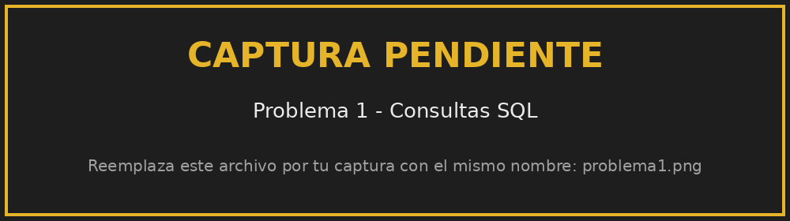
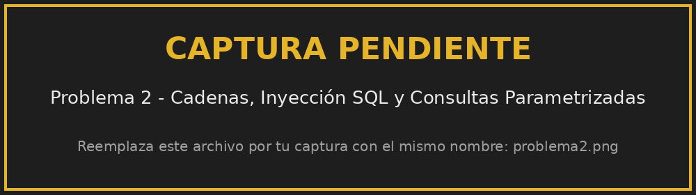
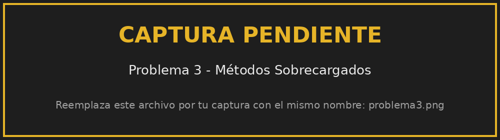
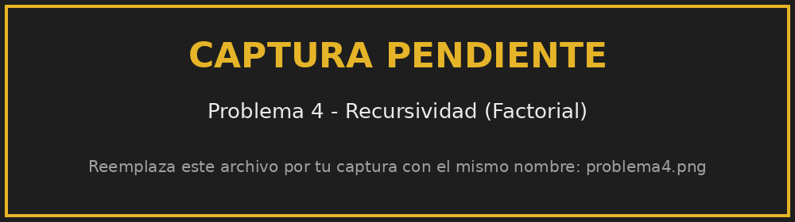
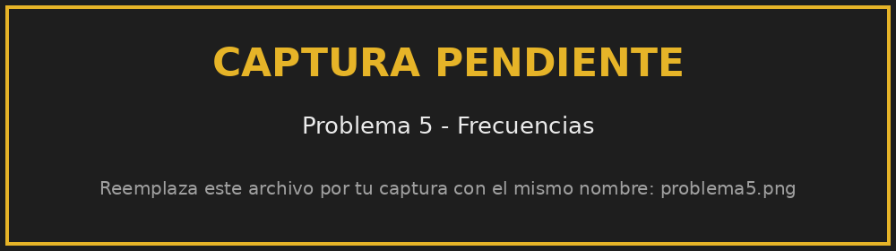

<div align="center">

# Laboratorio 5 – Temas Varios
### Repaso del CRUD, Inyección SQL, Consultas Parametrizadas, Métodos Sobrecargados, Recursividad y Frecuencias

**Universidad Tecnológica de Panamá**<br>
Facultad de Ingeniería de Sistemas Computacionales<br>
Herramientas de Programación Aplicada III (.NET)

</div>

| Dato | Información |
|---|---|
| **Estudiante** | Christian Arce |
| **Cédula** | ✏️ *Tu cédula* |
| **Grupo** | 1IL133 |
| **Instructora** | Ing. Irina Fong |
| **Módulo** | IV – Acceso a Base de Datos, Aplicaciones en Capas |
| **Fecha de entrega** | ✏️ *dd de mes de 2026* |

---

## 📋 Descripción

Aplicación de consola en **C#** con un menú que ejecuta los 5 problemas del laboratorio:

| # | Problema | Archivo |
|---|---|---|
| 1 | Consultas SQL (3) | `Problema1.cs` |
| 2 | Armar `INSERT` / `UPDATE` con cadenas, Inyección SQL y Consultas Parametrizadas | `Problema2.cs` |
| 3 | Métodos Sobrecargados | `Calculadora.cs`, `Problema3.cs` |
| 4 | Recursividad: Factorial (n!) | `Problema4.cs` |
| 5 | Frecuencias | `Problema5.cs` |

La base de datos es **SQLite en memoria**: se crea sola al ejecutar el programa, por lo que **no hay que instalar ningún servidor de base de datos**.

---

## 🛠️ Tecnologías y versiones

| Tecnología | Versión |
|---|---|
| .NET SDK | **8.0** (LTS) |
| Lenguaje C# | **12** |
| Microsoft.Data.Sqlite (NuGet) | 8.0.11 |
| Base de datos | SQLite (en memoria) |
| IDE | Visual Studio 2022 / 2026 (Community) |
| Sistema operativo | Windows 10 / 11 |

> El proyecto tiene `RollForward = Major`, así que también funciona si solo está instalado un .NET más nuevo (por ejemplo .NET 10).

---

## 📁 Estructura del repositorio

```
Lab-Temas-Varios/
├── LabTemasVarios.sln          ← Solución (abrir este archivo)
├── README.md
├── .gitignore
├── capturas/                   ← Evidencias (capturas de pantalla)
└── LabTemasVarios/
    ├── LabTemasVarios.csproj
    ├── Program.cs              ← Menú
    ├── BaseDatos.cs            ← Crea la base SQLite en memoria
    ├── Problema1.cs
    ├── Problema2.cs
    ├── Calculadora.cs          ← Clase con métodos sobrecargados
    ├── Problema3.cs
    ├── Problema4.cs
    └── Problema5.cs
```

---

## 🚀 Guía de instalación y uso (Onboarding)

### Requisitos
- [.NET SDK 8.0 o superior](https://dotnet.microsoft.com/download)
- Visual Studio 2022/2026 con la carga de trabajo **"Desarrollo de escritorio de .NET"** (opcional: también se puede usar solo la terminal)
- Conexión a internet la primera vez (para descargar el paquete de SQLite)

### 1. Clonar el repositorio
```bash
git clone https://github.com/TU-USUARIO/Lab-Temas-Varios.git
cd Lab-Temas-Varios
```

### 2. Restaurar dependencias
```bash
dotnet restore
```

### 3. Ejecutar

**Opción A – Visual Studio:** abrir `LabTemasVarios.sln` y presionar **F5** (o el botón verde ▶).

**Opción B – Terminal:**
```bash
dotnet run --project LabTemasVarios
```

### 4. Usar el menú
```
Laboratorio 5
Grupo: 1IL133
Christian Arce

1. Problema 1
2. Problema 2
3. Problema 3
4. Problema 4
5. Problema 5
0. Salir
Opcion:
```
Escribir el número del problema y presionar **ENTER**. Al terminar, **ENTER** vuelve al menú. La opción **0** cierra el programa.

---

## 🧩 Problema 1: Consultas SQL

Tres consultas sobre la tabla `Estudiantes`:

1. Todos los estudiantes – `SELECT * FROM Estudiantes`
2. Estudiantes mayores de 20 (con parámetro) – `WHERE Edad > @edad`
3. Cantidad de estudiantes por carrera – `COUNT(*)` con `GROUP BY`

```csharp
cmd2.CommandText = "SELECT Nombre, Edad FROM Estudiantes WHERE Edad > @edad";
cmd2.Parameters.AddWithValue("@edad", 20);
```



---

## 🧩 Problema 2: Cadenas (INSERT / UPDATE), Inyección SQL y Consultas Parametrizadas

Funciones que arman el SQL **pegando cadenas**:

```csharp
static string ArmarInsert(string nombre, string carrera, int edad)
{
    return "INSERT INTO Estudiantes (Nombre, Carrera, Edad) VALUES ('" + nombre + "', '" + carrera + "', " + edad + ")";
}

static string ArmarUpdate(int id, string nombre)
{
    return "UPDATE Estudiantes SET Nombre = '" + nombre + "' WHERE Id = " + id;
}
```

Si el usuario escribe como nombre `Hackeado' --`, el SQL queda así:

```sql
UPDATE Estudiantes SET Nombre = 'Hackeado' --' WHERE Id = 1
```

El `'` cierra el texto y el `--` convierte el `WHERE` en comentario, así que se modifican **todos** los estudiantes (Inyección SQL).

Con una **consulta parametrizada** el valor va separado del SQL y solo se modifica el estudiante con `Id = 1`:

```csharp
cmd.CommandText = "UPDATE Estudiantes SET Nombre = @nombre WHERE Id = @id";
cmd.Parameters.AddWithValue("@nombre", nombreMalicioso);
cmd.Parameters.AddWithValue("@id", 1);
```

| | Filas modificadas |
|---|---|
| ❌ Con cadenas | **6 (todas)** |
| ✅ Parametrizada | **1** |



---

## 🧩 Problema 3: Métodos Sobrecargados

La clase `Calculadora` tiene **4 métodos llamados `Sumar`** con distintos parámetros. C# elige cuál usar según los datos que recibe.

```csharp
public int Sumar(int a, int b)
public int Sumar(int a, int b, int c)
public double Sumar(double a, double b)
public int Sumar(int[] numeros)
```



---

## 🧩 Problema 4: Recursividad – Factorial (n!)

```csharp
static long Factorial(int n)
{
    if (n <= 1)   // caso base
    {
        return 1;
    }
    return n * Factorial(n - 1);   // se llama a si misma
}
```

- El **caso base** (`n <= 1`) detiene la recursión y evita el *StackOverflow*.
- Solo se aceptan números del 0 al 20, porque `21!` ya no cabe en un `long`.



---

## 🧩 Problema 5: Frecuencias

Se recorre el arreglo y se usa un `Dictionary<int, int>` para guardar cuántas veces aparece cada número:

```csharp
foreach (int n in numeros)
{
    if (frecuencias.ContainsKey(n))
    {
        frecuencias[n]++;
    }
    else
    {
        frecuencias[n] = 1;
    }
}
```

Al final se muestra cada número con su frecuencia.



---

## ✅ Conclusiones

- Armar SQL pegando datos del usuario es peligroso porque permite la **Inyección SQL**.
- Las **consultas parametrizadas** separan el SQL de los datos y evitan ese problema.
- La **sobrecarga de métodos** permite usar el mismo nombre con distintos parámetros.
- Toda función **recursiva** necesita un **caso base**.
- Con un **diccionario** se pueden contar las frecuencias recorriendo los datos una sola vez.

---

<div align="center">
<sub>Christian Arce · Universidad Tecnológica de Panamá · Herramientas de Programación Aplicada III (.NET) · Grupo 1IL133 · Fecha de entrega: ✏️ <i>dd de mes de 2026</i></sub>
</div>
